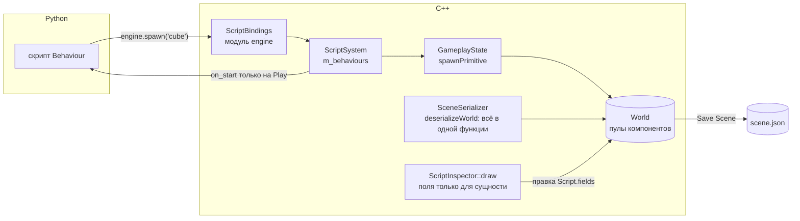
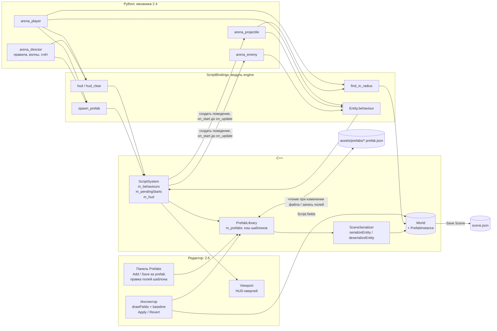

# ЛР 2 «Скриптинг»: пункты 2.4–2.6

Документ описывает, что добавлено в движок для пунктов 2.4-2.6.


## 1. С чего начинали (после 2.1–2.3)

До начала работы над 2.4–2.6 в движке уже было:

| Что | Где | Простыми словами |
|---|---|---|
| Встроенный Python 3.12 (embeddable) | `src/Scripting/ScriptEngine.cpp` | Интерпретатор запускается при старте приложения (`Application::initialize`) и останавливается при выходе. Рантайм лежит рядом с exe в папке `python/`. |
| Модуль `engine` для скриптов | `src/Scripting/ScriptBindings.cpp` | Через него скрипт видит движок: сущности (`Entity`), позиции, ввод, `spawn` примитивов, `destroy`, `find`. |
| Базовый класс поведения | `ScriptBehaviour` + trampoline `PyScriptBehaviour` | Скрипт пишет `class X(engine.Behaviour)` и переопределяет `on_start`, `on_update`, `on_destroy`. C++ вызывает их через виртуальные методы. |
| Компонент `Script` | `src/Components/Script.h` | Только данные: имя модуля, имя класса и JSON полей. Живые Python-объекты хранит `ScriptSystem`, а не компонент. |
| `ScriptSystem` | `src/Systems/ScriptSystem.cpp` | На Play создаёт поведения у всех сущностей со `Script`, каждый кадр вызывает `on_update`, на Stop всё уничтожает. |
| Hot reload | `ScriptEngine::pollFileChanges` | Раз в 0.5 с проверяет время изменения `.py`. Вне Play делает `importlib.reload`. |
| Поля поведения | `src/Scripting/ScriptFields.h` | Скрипт объявляет `editor_fields` (тип, default, min/max, enum, entity). C++ читает схему, проверяет значения и записывает их в объект. |
| Инспектор полей | `src/Scripting/ScriptInspector.h` | Виджеты ImGui по типу поля: слайдер, чекбокс, список, выбор сущности. |
| Ссылки на сущности | `src/Scripting/EntityReferenceData.h`, `scripts/engine_fields.py` | В JSON ссылка хранится как `{"$entity": id}`. При загрузке сцены id переназначаются, ссылка на удалённый объект становится `None`. |

Чего не было:
- шаблонов объектов (prefab);
- создания поведения у объектов, заспавненных во время Play;
- связи «объект в сцене ↔ шаблон»;
- самой механики.

---

## 2. Порядок работы: 2.5 → 2.6 → 2.4

- **2.4 зависит от 2.5.** ТЗ: «Механика из 2.4 обязана пользоваться шаблонным спавном», а параметры баланса должны задаваться «данными шаблона, а не константами в коде скрипта». Без шаблонов механику пришлось бы потом переписывать.
- **2.6 на старте был сделан почти полностью.** Инспектор и сохранение в сцену уже были. Не хватало сохранения правки **в шаблон**, а для этого сначала нужны шаблоны.
- **2.4 последним.** Механика опирается на всё сразу: спавн из шаблонов, баланс в данных, правку правил в редакторе на ходу.

---

## 3. Пункт 2.5. Шаблонный спавн (prefab)

### 3.1. Что требует ТЗ

> Data-driven описание шаблона объекта: набор компонентов и начальные значения в файле (JSON/YAML), спавн экземпляра из скрипта одной командой. Начальные значения включают поля скриптовых поведений. Механика из 2.4 обязана пользоваться шаблонным спавном.

### 3.2. Что реализовано

1. **Формат шаблона.** Файл `assets/prefabs/<имя>.prefab.json`:

   ```json
   {
       "version": 1,
       "entity": {
           "tag":           { "name": "Enemy" },
           "transform":     { "position": [0,0,0], "rotation": [0,0,0], "scale": [0.9,0.9,0.9] },
           "mesh_renderer": { "mesh": { "type": "sphere", "radius": 0.5 }, "material": { ... } },
           "script": {
               "module": "arena_enemy",
               "class":  "ArenaEnemy",
               "fields": { "speed": 2.0, "hp": 2, "damage": 1, "touch_radius": 0.9, "score": 10 }
           }
       }
   }
   ```

   Внутри `entity` тот же формат, что у сущности в файле сцены. Поэтому шаблон понимает все компоненты, которые понимает сцена (`transform`, `tag`, `mesh_renderer`, `rigidbody`, `collider`, `light`, `camera`, `script`), и читается тем же кодом.

2. **Класс `PrefabLibrary`** (`src/Gameplay/PrefabLibrary.h/.cpp`) — библиотека шаблонов:
   - `instantiate(world, name, position, fieldOverrides)` создаёт экземпляр;
   - `list()` возвращает список шаблонов для редактора;
   - `saveFromEntity(world, entity, name)` сохраняет выбранный объект как шаблон;
   - `getScript(name)` и `saveScriptFields(name, fields)` читают и пишут поля скрипта шаблона (нужно для 2.6).

3. **Команда для скрипта:**

   ```python
   enemy = engine.spawn_prefab("arena_enemy", engine.Vec3(x, 0.9, z),
                               {"target": player, "director": self.entity})
   ```

   Третий аргумент необязателен: он переопределяет поля скрипта поверх значений из шаблона. Можно передавать числа, bool, строки и `engine.Entity` (сохраняется как ссылка).

4. **Поведение заспавненного объекта запускается сразу.** `ScriptSystem::spawnPrefab` создаёт Python-поведение тут же. Его `on_start` гарантированно вызывается до первого `on_update` (раньше у объектов, созданных в Play, поведение не создавалось вообще).

5. **Панель Prefabs в редакторе**: список шаблонов, кнопки «Add to scene» и «Save selected as prefab».

6. **Демо-шаблоны**: `ball` и `ball_spawner` для проверки спавна, `arena_*` для механики 2.4.

### 3.3. По какому принципу

**Один формат и один код для сцены и шаблона.** Код разбора компонентов из `SceneSerializer::deserializeWorld` вынесен в функцию `SceneSerializer::deserializeEntity`, которая заполняет одну сущность. Сцена вызывает её для каждой сущности, `PrefabLibrary::instantiate` вызывает её для экземпляра шаблона. Если добавить новый компонент в сериализатор, шаблоны получат его автоматически.

**Кэш с проверкой времени изменения файла.** `PrefabLibrary` хранит разобранные шаблоны в `std::unordered_map<std::string, Prefab> m_prefabs`. При каждом спавне функция `get(name)` сравнивает время изменения файла с запомненным:
- время не изменилось → шаблон берётся из кэша, файл не читается;
- изменилось → файл перечитывается. Это и есть «перезагрузка данных на ходу»: поменяли число в JSON, и следующий спавн уже с новым значением, даже во время Play;
- новый файл битый → в лог пишется ошибка с файлом, строкой и колонкой (`nlohmann::json::parse_error`), а **в кэше остаётся предыдущая рабочая версия**, и игра продолжается.

**Общие меш и материал на все экземпляры.** В движке `MeshFactory::createCube/createSphere` каждый раз создаёт новый `Mesh`, а конструктор `Material` линкует новую шейдерную программу OpenGL. Если делать так на каждый спавн, то при волнах врагов и снарядах память и GPU-объекты растут без ограничений. Поэтому `MeshRenderer` строится **один раз на версию шаблона** (`Prefab::renderer`) и копируется в каждый экземпляр: копируются указатели, а не данные.

**Позиция задаётся при спавне.** Позиция из шаблона игнорируется, берётся та, что передал скрипт. Поворот и масштаб берутся из шаблона.

**Ссылки на сущности внутри шаблона обнуляются.** id объектов сцены в шаблоне бессмысленны, потому что шаблон спавнится в любой сцене. `deserializeEntity` вызывается с пустой `idMap`, и `EntityReferenceData::remapFields` превращает такие ссылки в `null`. Ссылку можно передать только при спавне через `fields`.

**Защита пути.** Имя шаблона может содержать только `[A-Za-z0-9_-]` (`PrefabLibrary::isValidName`). Скрипт не может написать `spawn_prefab("../../x")` и прочитать файл за пределами папки.

**Папка шаблонов в отладочной сборке.** CMake передаёт `ENGINE_PREFABS_SOURCE_DIR` = `<исходники>/assets/prefabs`. Если папка существует, шаблоны читаются оттуда, а не из копии рядом с exe. Так правка файла в репозитории сразу видна в запущенном движке. Тот же приём уже использовался для скриптов (`ENGINE_SCRIPTS_SOURCE_DIR`).

### 3.4. Гарантии для заспавненного поведения

Сценарий: скрипт A в своём `on_update` вызывает `spawn_prefab`, у шаблона есть скрипт B.

1. `PrefabLibrary::instantiate` создаёт сущность и компоненты, в том числе `Script` с полями (шаблон + overrides).
2. `ScriptSystem::activateSpawned` сразу создаёт объект B: вызывает конструктор класса, записывает `entityId`, применяет и проверяет поля. Поэтому A может тут же сделать `shot.behaviour.launch(direction)`.
3. id сущности кладётся в очередь `m_pendingStarts`.
4. После цикла `on_update` текущего кадра `flushPendingStarts()` вызывает `B.on_start()`. B не получает `on_update` раньше `on_start`.
5. Если `on_start` сам спавнит объекты, очередь разбирается повторно, но не больше 16 раундов за кадр (`MAX_START_ROUNDS`). Скрипт, который бесконечно спавнит из `on_start`, не подвесит кадр: остаток переносится на следующий.

### 3.5. Обработка ошибок (стабильность)

| Ситуация | Что происходит |
|---|---|
| Нет файла шаблона | Лог `Prefab 'x' not found: <путь>`, в скрипт летит `RuntimeError("Cannot spawn prefab 'x', see the engine log")`. Поведение-спавнер отключается до следующего Play, движок работает. |
| Битый JSON | Лог с файлом, строкой и колонкой. Если была рабочая версия, используется она. |
| Неизвестный компонент в шаблоне | Предупреждение в лог, компонент пропускается. |
| У `script` пустой `module` или `class` | Ошибка в лог, шаблон не загружается. |
| Значение поля вне `min/max` или не того типа | Ошибку ловит `ScriptFields::apply` при создании поведения: лог с именем поля, объект живёт без поведения. |
| Неверный тип в `fields` при `spawn_prefab` | `TypeError("Field 'x': ...")` в скрипт. |

---

## 4. Пункт 2.6. Правка полей в редакторе

### 4.1. Что требует ТЗ

> Выделили объект в редакторе → видны поля его скриптового поведения с текущими значениями → значение можно поменять → правка сохраняется в сцену/шаблон и применяется при следующем спавне/play.

### 4.2. Что было и чего не хватало

Было: инспектор полей (`ScriptInspector::draw`) и сохранение в сцену через `File → Save Scene`.

Не хватало:
1. Объект в сцене не знал, из какого шаблона он создан.
2. Правку объекта нельзя было вернуть в шаблон, кроме как перезаписать шаблон целиком.
3. Шаблон нельзя было править, не ставя его экземпляр в сцену.

### 4.3. Что реализовано

1. **Компонент-связь `PrefabInstance`** (`src/Components/PrefabInstance.h`) — одно поле `prefab` с именем шаблона.
   - Ставится в `PrefabLibrary::instantiate` (при спавне из скрипта и при «Add to scene») и в `saveFromEntity` («Save selected as prefab»).
   - Сохраняется в сцене как `"prefab": { "name": "arena_enemy" }`, поэтому переживает сохранение, загрузку и переход Play → Stop (сцена восстанавливается из `temp_save.json`).
   - В сам файл шаблона этот ключ не пишется.

2. **Сравнение с шаблоном в инспекторе.** Если у выделенного объекта есть `PrefabInstance`, инспектор загружает поля шаблона (`PrefabLibrary::getScript`) и передаёт их как `baseline`:
   - поле, отличное от шаблона, помечается жёлтой `*`, при наведении видно значение шаблона;
   - числа сравниваются с допуском `1e-5`: через виджеты они проходят как `float`, и `0.3` превращается в `0.30000001192`;
   - кнопка `Reset` у поля возвращает **значение шаблона**, а не default из скрипта.

3. **Кнопки у экземпляра:**
   - **Apply fields to prefab** — поля объекта сливаются поверх полей шаблона и записываются в файл;
   - **Revert to prefab** — полям объекта возвращаются значения шаблона. Ссылки на объекты сцены (`{"$entity": id}`) при этом сохраняются, потому что в шаблоне их нет по определению.

4. **Правка шаблона прямо в панели Prefabs.** Щелчок по имени шаблона открывает его поля с теми же виджетами, кнопки «Save to prefab» и «Discard», пометку `unsaved`.
   - Пока вы ничего не меняли, панель каждый кадр показывает актуальное содержимое файла, в том числе если файл поправили вручную.
   - **Работает во время Play**: сохранённое значение применяется к следующему спавну. Это главный инструмент для живой проверки на приёмке.
   - Поля типа `entity` здесь показываются как недоступные: шаблон не может ссылаться на объект конкретной сцены.

5. **Запись только полей скрипта.** `PrefabLibrary::saveScriptFields` читает **сырой файл** (не кэш: в кэше вырезан `mesh_renderer`), заменяет только `entity.script.fields` и записывает файл обратно. Меш, материал, физика остаются нетронутыми. После записи запись в кэше удаляется (`m_prefabs.erase(name)`), чтобы следующий спавн перечитал файл, даже если файловая система не успела обновить время изменения.

### 4.4. Куда сохраняется правка и когда применяется

| Где правите | Куда пишется | Когда применяется |
|---|---|---|
| Инспектор объекта сцены (вне Play) | `Script.fields` в мире → в сцену при `Save Scene` | При следующем Play |
| Инспектор экземпляра → **Apply fields to prefab** | Файл шаблона | При следующем спавне этого шаблона |
| Панель Prefabs → **Save to prefab** (можно в Play) | Файл шаблона | При следующем спавне (во время Play сразу) |
| **Save selected as prefab** | Новый или перезаписанный файл шаблона целиком | При следующем спавне |

### 4.5. По какому принципу

- **Один код рисования полей.** `ScriptInspector::draw` разделён на заголовок и `drawFields(script, world, options)`. `drawFields` работает с любым объектом `Script`: с компонентом в мире или с копией из шаблона. Отличия задаются структурой `DrawOptions`:
  - `baseline` — указатель на JSON полей шаблона (для `*` и Reset);
  - `allowEntityReferences` — разрешены ли поля-ссылки.
- **Проверка значений одна на всех.** И в сцене, и в шаблоне значение проходит `ScriptFields::validationError` по схеме `editor_fields` из Python-класса. В шаблон нельзя записать значение вне `min/max`.
- **Во время Play поля экземпляров не правятся.** Живые значения в Python и `Script.fields` в этот момент — разные вещи, и правка ушла бы в сцену, которую Stop всё равно откатит. Шаблон править можно: это данные для будущих спавнов.

---

## 5. Пункт 2.4. Механика целиком на скриптах: «Арена: волны врагов»

### 5.1. Что требует ТЗ

> Одна механика игры, реализованная целиком на скриптах: логика, состояние, реакция на события. «Целиком» = игровые решения принимает скрипт. Движок предоставляет сервисы (ввод, запросы коллизий, рендер, события), но не логику механики. Живой критерий: изменить правило механики (число, условие, порядок) → правка скрипта или данных → reload → изменение видно в игре.

### 5.2. Что за игра

- Игрок (синий куб) ездит по арене **стрелками** и стреляет на **F**. С автоприцелом пуля летит в ближайшего врага, без него — в направлении последнего движения.
- Враги появляются **волнами** на краях арены и идут к игроку. Обычные (красные) медленные, элитные (фиолетовые) быстрые и хрупкие.
- Пуля попала → враг теряет HP. HP кончилось → враг умирает, игрок получает очки.
- Враг коснулся игрока → у игрока минус HP, враг исчезает.
- **Победа**: пройдены все волны или (если задано) набрано `win_score` очков.
- **Поражение**: HP игрока кончилось.
- **R** — перезапуск арены без выхода из Play.
- HUD поверх вьюпорта: волна, число врагов, счёт, пауза до следующей волны, HP, сообщение о победе или поражении.

WASD, Space и Ctrl заняты камерой редактора (`CameraSystem` и действия в `Application::bindActions`), поэтому у игрока стрелки, F и R.

### 5.3. Кто что решает: граница C++ и скриптов

| Решение | Кто принимает |
|---|---|
| Когда начинается волна, сколько врагов, какой из них элитный | `arena_director.py` |
| Победа, поражение, перезапуск, счёт | `arena_director.py` |
| Куда идёт враг, когда он «укусил» игрока | `arena_enemy.py` |
| Попала ли пуля, сколько урона | `arena_projectile.py` |
| Движение игрока, перезарядка, автоприцел | `arena_player.py` |
| Чтение клавиш, позиции, спавн/удаление, «кто в радиусе», вывод текста | **C++ (сервисы)** |

В C++ нет ни одной строки, которая знает про волны, HP, очки или врагов. Если удалить четыре `.py` файла, движок ничего не потеряет.

### 5.4. Сервисы, добавленные в движок для механики

Механике нужно было «видеть» мир и общаться между скриптами. Добавлено три сервиса общего назначения:

| API в Python | Категория из ТЗ | Зачем механике |
|---|---|---|
| `engine.find_in_radius(center, radius, name="")` | Запросы к миру | Пуля ищет врага рядом, игрок ищет ближайшего врага для прицела. Возвращает список, ближайшие первыми, с фильтром по тегу. Это «запрос коллизий», которого в движке не было. |
| `entity.behaviour` | Работа с сущностями | Скрипты вызывают методы друг друга: `enemy.behaviour.take_damage(1)`, `director.behaviour.on_enemy_removed(...)`. Возвращает живой Python-объект поведения или `None`. |
| `engine.hud(key, text)`, `engine.hud_clear(key="")` | Рендер (сервис вывода) | Счёт, волна и HP на экране. Строки сортируются по ключу (`1_wave`, `2_hp`, `3_result`) и очищаются при Stop. |

С учётом того, что было раньше, механика использует все четыре обязательные категории API: сущности и трансформ (`position`, `name`, `behaviour`), ввод (`is_key_down`, `is_key_pressed`), спавн и удаление (`spawn_prefab`, `destroy`), запросы к миру (`find`, `find_in_radius`).

**Владение на границе.** `entity.behaviour` возвращает сильную ссылку на Python-объект. Если скрипт сохранит её, а сущность потом удалят, объект останется жив в памяти Python, но `self.entity` у него станет невалидным: любое обращение даст `RuntimeError`, а не обращение к освобождённой памяти C++. Поэтому скрипты механики берут `.behaviour` каждый раз заново и не хранят его между кадрами. Между кадрами хранятся только слабые handles `engine.Entity` с проверкой `is_valid()`.

### 5.5. Шаблоны механики: где лежит баланс

| Шаблон | Тег | Скрипт | Поля (баланс) |
|---|---|---|---|
| `arena_director` | Wave Director | `arena_director.ArenaDirector` | `waves=5`, `first_wave_size=3`, `wave_growth=2`, `elite_every=4`, `spawn_interval=0.6`, `wave_pause=3.0`, `arena_half_size=8.5`, `win_score=0`, имена шаблонов игрока и врагов |
| `arena_player` | Player | `arena_player.ArenaPlayer` | `speed=6`, `max_hp=5`, `fire_cooldown=0.25`, `auto_aim=true`, `aim_range=12`, `projectile_prefab`, `arena_half_size` |
| `arena_enemy` | Enemy | `arena_enemy.ArenaEnemy` | `speed=2`, `hp=2`, `damage=1`, `touch_radius=0.9`, `score=10` |
| `arena_enemy_fast` | Enemy | тот же `ArenaEnemy` | `speed=4`, `hp=1`, `touch_radius=0.7`, `score=15`, меньше и другого цвета |
| `arena_projectile` | Projectile | `arena_projectile.ArenaProjectile` | `speed=14`, `damage=1`, `lifetime=1.5`, `hit_radius=0.6` |

Обычный и быстрый враг — **один и тот же скрипт** с разными данными. Это прямо показывает принцип «баланс в данных шаблона».

У объектов механики нет `Rigidbody` и `Collider`: их двигают скрипты, а `PhysicsSystem` обрабатывает только сущности, у которых есть оба компонента. Физика декораций сцены (шары, стены) не затронута.

### 5.6. Логика по скриптам

**`arena_director.py` — правила режима, конечный автомат:**

```
pause ──(таймер wave_pause истёк)──► spawning ──(все враги волны выпущены)──► fighting
  ▲                                                                              │
  └──────────────────────(врагов не осталось, волна < waves)─────────────────────┘
fighting ──(врагов нет и волна == waves)──► won
любое активное состояние ──(HP игрока = 0)──► lost
любое активное состояние ──(win_score > 0 и score >= win_score)──► won
любое состояние ──(R)──► _restart() → pause
```

- `on_start`: ищет `Player` в сцене, если его нет — спавнит `player_prefab` в центре, затем `_restart()`.
- `wave_size(n) = first_wave_size + (n-1) * wave_growth`.
- `is_elite(i)`: `elite_every > 0 and i % elite_every == 0`, то есть каждый N-й враг в волне элитный.
- `_spawn_enemy`: случайная точка на одной из четырёх сторон арены, `spawn_prefab(enemy или elite, pos, {"target": игрок, "director": self.entity})`.
- `on_enemy_removed(enemy, killed, score)`: вызывается врагом, при `killed=True` прибавляет очки.
- `_finish(won)`: убирает оставшихся врагов, пишет итог в лог и HUD.
- `_restart()`: убирает врагов, обнуляет счёт и волну, вызывает `player.reset()`, очищает строку результата.
- Список `self._enemies` хранит слабые handles и каждый кадр чистится через `is_valid()`.

**`arena_enemy.py`:**
- поля-ссылки `target` и `director` (тип `entity`) приходят из `spawn_prefab(..., fields)`;
- каждый кадр шаг к цели в плоскости XZ, не больше оставшегося расстояния;
- если дистанция ≤ `touch_radius`: `player.take_damage(damage)`, затем `_die(killed=False)`;
- `take_damage`: `hp -= amount`, при `hp <= 0` → `_die(killed=True)`;
- `_die`: ставит флаг `_dead`, сообщает директору и удаляет свою сущность;
- `_dead = False` задан на уровне класса, потому что пуля может попасть раньше, чем у врага вызовется `on_start`.

**`arena_projectile.py`:**
- `launch(direction)` вызывает игрок сразу после спавна, то есть **до** `on_start`. Поэтому направление и возраст пули — атрибуты класса с безопасными значениями по умолчанию;
- каждый кадр шаг вперёд, затем `find_in_radius(pos, hit_radius, "Enemy")`; первый найденный получает урон, пуля удаляется;
- по истечении `lifetime` пуля удаляется сама.

**`arena_player.py`:**
- `reset()` восстанавливает HP, перезарядку и направление;
- `take_damage()` уменьшает HP, при нуле `alive = False`;
- `_move`: стрелки задают вектор движения (вверх = −Z), позиция ограничена квадратом арены;
- `_shoot`: при `auto_aim` целится в ближайшего врага в радиусе `aim_range` (`find_in_radius`), иначе стреляет в направлении последнего движения; спавнит `projectile_prefab` и вызывает `shot.behaviour.launch(direction)`.

### 5.7. Как менять правила на приёмке (живой критерий)

| Просьба преподавателя | Что сделать | Где |
|---|---|---|
| «Пусть будет 3 волны» | `waves = 3` → Save to prefab | Prefabs → `arena_director`, можно в Play |
| «Больше врагов в волне» | `first_wave_size`, `wave_growth` | там же |
| «Каждый второй враг быстрый» / «без быстрых» | `elite_every = 2` / `0` | там же |
| «Победа по очкам, а не по волнам» | `win_score = 50` | там же |
| «Враги быстрее и толще» | `speed`, `hp` | Prefabs → `arena_enemy`, применится к следующему спавну |
| «Пуля сильнее» | `damage` | Prefabs → `arena_projectile` |
| «Без автоприцела» | `auto_aim = false` | Prefabs → `arena_player` (применится при следующем спавне игрока, то есть после Stop/Play, если игрока создаёт директор) |
| «Измени логику, например элитный каждый третий начиная с первого» | правка `is_elite` в `arena_director.py` | Stop → правка `.py` → Play (hot reload из 2.3) |


## 6. Как пункты закрывают критерии приёмки

| Критерий из ТЗ | Как закрыт |
|---|---|
| Механика из 2.4 играется | Арена: волны, стрельба, счёт, победа и поражение, перезапуск |
| Правило меняется по просьбе без перезапуска | Данные: панель Prefabs → Save to prefab (в Play). Код: Stop → правка `.py` → Play |
| Механика спавнит объекты из шаблонов (2.5) | Игрок, враги и пули создаются только через `engine.spawn_prefab` |
| Поля поведения правятся в редакторе и сохраняются (2.6) | Инспектор + Apply/Revert для экземпляров, правка шаблона в панели Prefabs, сохранение в сцену |
| Сломанный скрипт + reload → движок жив, в логе файл:строка | Ошибки Python логируются с traceback (из 2.1–2.3). Ошибки шаблона — с файлом и строкой JSON. Отказ одного поведения не валит остальные. |
| Длинная сессия без утечек state'а | Меш и материал общие на шаблон, а не на спавн. Handles слабые. На Stop очищаются `m_behaviours`, `m_pendingStarts`, `m_hud`. |
| Корректный выход | Порядок не менялся: `ScriptSystem::stop` → `ScriptEngine::shutdown` в `Application` |

---

## 7. Схема: как было и как стало

### 7.1. Было (после 2.1–2.3)



Чего не хватало на этой схеме:
- спавн только примитивов `cube`/`sphere` без компонентов и без скрипта;
- у объекта, созданного в Play, поведение не создавалось;
- правка полей доходила только до сцены;
- механики не было.

### 7.2. Стало (после 2.4–2.6)



Что изменилось:
- **Сцена и шаблон** читаются одной функцией `deserializeEntity`.
- **Спавн** идёт из шаблона с данными и скриптом, поведение запускается сразу.
- **Правка полей** может уйти в сцену, в шаблон или прямо в файл шаблона из панели.
- **Механика** живёт целиком в Python, движок даёт ей только сервисы.

---

## 8. Полный пайплайн работы скриптинга в движке

### 8.1. Старт приложения

```
main → Application::initialize
  ├─ OpenGLRenderAdapter::initialize            окно, OpenGL, ImGui
  ├─ AssetLoader / ShaderLoader / TextureLoader загрузчики ресурсов
  ├─ ScriptEngine::initialize                   (2.1)
  │    ├─ ищет python/python312.zip рядом с exe
  │    ├─ scripts dir = <исходники>/scripts (dev) или <exe>/scripts
  │    └─ Py_InitializeFromConfig (изолированный конфиг, пути поиска модулей)
  └─ GameplayState(renderer)
       ├─ m_prefabs = PrefabLibrary(renderer)    (2.5) prefabs dir = <исходники>/assets/prefabs (dev)
       └─ setupEditorCallbacks → renderer.setPrefabLibrary(m_prefabs)   (2.6)
GameplayState::onEnter
  ├─ new World
  ├─ addSystem: Physics, Camera, Movement, ScriptSystem(spawnPrimitive, prefabSpawn), Transform, Render
  └─ SceneSerializer::loadScene(test_scene.json)
       └─ deserializeWorld: pass 1 — новые id и idMap; pass 2 — deserializeEntity для каждой сущности
          (включая Script с переназначением ссылок и PrefabInstance); pass 3 — связи иерархии
```

### 8.2. Кадр в режиме редактирования (Edit)

```
Application::update
  ├─ InputHandler::update + события окна
  └─ World::update → системы по порядку:
       Physics (выключена до Play) → Camera → Movement →
       ScriptSystem::update
         └─ ScriptEngine::pollFileChanges(dt, allowReload = true)     (2.3)
              раз в 0.5 с: изменился .py → importlib.reload
       → Transform → Render
Application::render → OpenGLRenderAdapter::render → renderUI
  ├─ Viewport (HUD не рисуется: getActiveSystem() == nullptr)
  ├─ Inspector → ScriptInspector::draw(script, world, {baseline})       (2.6)
  │     └─ Apply / Revert → PrefabLibrary::saveScriptFields / getScript
  └─ Prefabs → list(), instantiate(), saveFromEntity(),
                правка полей шаблона → saveScriptFields                 (2.5 / 2.6)
```

### 8.3. Нажатие Play

```
GameplayState::enterPlayMode
  ├─ saveSceneState → temp_save.json (снимок для отката на Stop)
  ├─ PhysicsSystem::setEnabled(true)
  └─ ScriptSystem::start(world)
       ├─ новый m_sessionId (handles прошлых Play становятся недействительными)
       ├─ ScriptEngine::setActiveSystem(this) — с этого момента работает API engine.*
       ├─ копия всех Script из пула → createBehaviour для каждой сущности:
       │     loadBehaviourClass(module, class) → экземпляр Python-класса
       │     → entityId → ScriptFields::apply (схема editor_fields, проверка, установка атрибутов)
       ├─ on_start у всех (после создания всех, чтобы скрипты могли найти друг друга)
       │     ArenaDirector.on_start → spawn_prefab("arena_player") → см. 8.5
       ├─ flushPendingStarts()  ← on_start у объектов, заспавненных из on_start
       └─ flushDestroyQueue()
```

### 8.4. Кадр в режиме Play

```
ScriptSystem::update
  ├─ pollFileChanges(dt, allowReload = false)  изменённые .py только помечаются «перезагрузится после Stop»
  ├─ flushPendingStarts()                      хвост из прошлого кадра (спавн из on_destroy)
  ├─ для каждого поведения: on_update(dt)
  │     ArenaDirector:  автомат волн → spawn_prefab(enemy, pos, {target, director}); hud(...)
  │     ArenaPlayer:    ввод → position; F → find_in_radius → spawn_prefab(projectile) → behaviour.launch()
  │     ArenaEnemy:     шаг к цели; касание → player.take_damage(); _die() → director.on_enemy_removed()
  │     ArenaProjectile: шаг; find_in_radius("Enemy") → enemy.take_damage(); destroy()
  │     исключение Python → лог с traceback, это поведение удаляется до следующего Play
  ├─ flushPendingStarts()                      on_start у всего, что заспавнили в этом кадре
  └─ flushDestroyQueue()                       on_destroy, затем World::destroyEntity
TransformSystem → новые матрицы
RenderSystem → отрисовка в текстуру
Viewport → картинка + HUD из ScriptSystem::getHud()
```

### 8.5. Спавн из шаблона во всех подробностях

```mermaid
sequenceDiagram
    participant Py as Python-скрипт
    participant B as ScriptBindings
    participant SS as ScriptSystem
    participant GS as GameplayState
    participant L as PrefabLibrary
    participant S as SceneSerializer
    participant W as World

    Py->>B: engine.spawn_prefab("arena_enemy", pos, {"target": player})
    B->>B: fieldsToJson: dict → JSON (Entity → {"$entity": id})
    B->>SS: spawnPrefab(name, pos, overrides)
    SS->>GS: m_prefabSpawnFunction(...)
    GS->>L: instantiate(world, name, pos, overrides)
    L->>L: get(name): время файла изменилось? → load() / кэш
    L->>W: createEntity()
    L->>S: deserializeEntity(entityJson, пустая idMap)
    S->>W: Transform, Tag, Script(fields)...
    L->>W: MeshRenderer (общий меш и материал шаблона)
    L->>W: position = pos; PrefabInstance{name}; Script.fields.update(overrides)
    L-->>SS: EntityId
    SS->>SS: activateSpawned: createBehaviour → объект Python, поля проверены
    SS->>SS: m_pendingStarts.push_back(id)
    SS-->>B: EntityId
    B-->>Py: engine.Entity (слабый handle: id + sessionId)
    Note over SS: в конце цикла on_update: flushPendingStarts() → on_start()
```

### 8.6. Нажатие Stop

```
GameplayState::exitPlayMode
  ├─ ScriptSystem::stop
  │     ├─ on_destroy у каждого поведения, затем m_behaviours.clear()
  │     ├─ m_destroyQueue, m_pendingStarts, m_hud очищены
  │     └─ setActiveSystem(nullptr): engine.* снова недоступен, HUD исчезает
  ├─ PhysicsSystem::setEnabled(false)
  └─ restoreSceneState: World::clear + loadScene(temp_save.json)
        все заспавненные в Play объекты исчезают; PrefabInstance у объектов сцены сохраняется
Следующий кадр Edit: pollFileChanges(allowReload = true) перезагружает .py, изменённые во время Play
```

### 8.7. Выход

```
Application::shutdown
  ├─ GameplayState::onExit → ScriptSystem::stop (если Play был активен)
  ├─ ScriptEngine::shutdown → m_modules.clear() → Py_Finalize
  └─ AssetLoader, JobSystem, renderer → shutdown
```

---

## 9. Карта изменений в коде: файл, строки, фрагмент, зачем

### 9.1. Основные контейнеры, с которыми идёт работа

| Контейнер | Где | Тип | Что хранит и почему такой |
|---|---|---|---|
| `World::componentPools` | `src/World.h` | `unordered_map<type_index, unique_ptr<IComponentPool>>` | По пулу на тип компонента. Новый тип `PrefabInstance` получил свой пул автоматически при первом `getComponentPool<PrefabInstance>()`. |
| `ComponentPool<T>::m_components` / `m_componentsEntities` / `m_componentsIdx` | `src/ComponentPool.h` | плотный `vector<T>` + `vector<EntityId>` + разреженный индекс | Компоненты лежат подряд для быстрого обхода, индекс даёт доступ по id за O(1). Важно: **`addComponent` может перевыделить вектор**, поэтому указатели на компоненты нельзя держать через вызовы, которые спавнят. Отсюда копия `Script` в `activateSpawned`. |
| `PrefabLibrary::m_prefabs` | `src/Gameplay/PrefabLibrary.h:62` | `unordered_map<string, Prefab>` | Глобальный (на `GameplayState`) кэш разобранных шаблонов: JSON компонентов без `mesh_renderer`, готовый `MeshRenderer`, время файла, флаг `valid`. Ключ — имя шаблона. |
| `ScriptSystem::m_behaviours` | `src/Systems/ScriptSystem.h` | `unordered_map<EntityId, py::object>` | Единственный владелец живых Python-поведений в C++. Живёт от `start()` до `stop()`. |
| `ScriptSystem::m_pendingStarts` | `src/Systems/ScriptSystem.h:72` | `vector<EntityId>` | Новое. Очередь заспавненных, у которых ещё не было `on_start`. Разбирается в `flushPendingStarts`. |
| `ScriptSystem::m_destroyQueue` | `src/Systems/ScriptSystem.h` | `vector<EntityId>` | Уже было. Отложенное удаление, чтобы не удалять сущность посреди обхода. |
| `ScriptSystem::m_hud` | `src/Systems/ScriptSystem.h:73` | `std::map<string, string>` | Новое. Строки HUD. `std::map`, а не `unordered_map`, потому что он упорядочен по ключу, и порядок строк на экране задаётся именами ключей (`1_wave`, `2_hp`, `3_result`). |
| `idMap` | локальная в `deserializeWorld` | `unordered_map<EntityId, EntityId>` | Старый id из файла → новый id в мире. При спавне шаблона передаётся пустая карта, поэтому все ссылки из шаблона становятся `null`. |
| `Script::fields` | `src/Components/Script.h` | `nlohmann::json` (объект) | Сохранённые значения полей поведения. Шаблон + overrides сливаются через `fields.update(...)`. |
| `OpenGLRenderAdapter::m_prefabNames`, `m_editedPrefabScript` | `src/OpenGLRenderAdapter.h:172, 180` | `vector<string>`, `Script` | Локальное состояние панели: кэш списка файлов (обновляется по Refresh и после сохранения) и редактируемая копия полей шаблона. |
| `DrawOptions::baseline` | `src/Scripting/ScriptInspector.h:297` | `const json*` | Невладеющий указатель на поля шаблона, живёт только в пределах кадра отрисовки инспектора. |

---

### 9.2. `src/Utils/Serialization/SceneSerializer.h/.cpp` (2.5, 2.6)

**Что добавлено:** функции для одной сущности (`serializeEntity`, `deserializeEntity`) и поддержка `PrefabInstance`.

**`SceneSerializer.h:13, 16, 28–32`** — объявления:

```cpp
#include "Components/PrefabInstance.h"
#include <unordered_map>
...
// One entity's components (no "id"). Shared by scenes and prefabs.
static nlohmann::json serializeEntity(World& world, EntityId entity);
// idMap remaps entity references in script fields; references absent from it become null
static void deserializeEntity(IRenderAdapter& renderAdapter, World& world, EntityId entity,
    const nlohmann::json& entityJson, const std::unordered_map<EntityId, EntityId>& idMap);
```

**`SceneSerializer.cpp:69–89` — `serializeWorld`** теперь обходит `world.getEntities()` по порядку id и для каждой сущности вызывает `serializeEntity`. Раньше здесь вручную собирались id из девяти пулов и сериализовались прямо в цикле.

**`SceneSerializer.cpp:91–137` — `serializeEntity`**: по одному `if` на компонент. В конце добавлена связь с шаблоном:

```cpp
if (auto* t = world.getComponent<PrefabInstance>(e))
{
    ej["prefab"] = { { "name", t->prefab } };
}
```

Зачем: сохранить, из какого шаблона объект, чтобы после загрузки сцены или Stop в инспекторе работали Apply/Revert.

**`SceneSerializer.cpp:139–186` — `deserializeWorld`** переписан на три прохода:

```cpp
// Pass 1: allocate new ids, so entity references (hierarchy, script fields) can be remapped
for (const auto& entityJson : entitiesArray) { ... idMap[oldId] = newId; entitiesData.emplace_back(newId, &entityJson); }
// Pass 2: components
for (const auto& [newId, entityJson] : entitiesData) deserializeEntity(renderAdapter, world, newId, *entityJson, idMap);
// Pass 3: hierarchy links
...
```

`entitiesData` — локальный `vector<pair<EntityId, const json*>>`: пары «новый id + указатель на JSON сущности», без копирования JSON.

**`SceneSerializer.cpp:188–236` — `deserializeEntity`**: заполняет компоненты одной сущности. Общая лямбда `apply` добавляет компонент, если его нет, и заполняет из JSON:

```cpp
auto apply = [&](const char* key, auto deserialize, auto component)
{
    using T = decltype(component);
    if (!ej.contains(key)) return;
    auto& pool = world.getComponentPool<T>();
    T* existing = pool.getComponent(entity);
    if (!existing) { pool.addComponent(entity, component); existing = pool.getComponent(entity); }
    deserialize(*existing, ej[key]);
};
apply("transform", &deserializeTransform, Transform{});
...
```

Скрипт отдельно, с переназначением ссылок, и связь с шаблоном:

```cpp
if (ej.contains("script"))
{
    Script s;
    deserializeScript(s, ej["script"]);
    // Ids of the source file are meaningless here: remap, unknown ones become null
    EntityReferenceData::remapFields(s.fields, idMap);
    world.getComponentPool<Script>().addComponent(entity, s);
}
if (ej.contains("prefab") && ej["prefab"].is_object())
{
    world.getComponentPool<PrefabInstance>().addComponent(entity,
        PrefabInstance{ ej["prefab"].value("name", "") });
}
```

Зачем: один код для сцены и шаблона. Для сцены `idMap` полная, для шаблона пустая.

---

### 9.3. `src/Components/PrefabInstance.h` (новый, 2.6)

```cpp
// Marks an entity spawned from a template, so the editor can apply or revert its
// script fields against assets/prefabs/<prefab>.prefab.json
class PrefabInstance : public Component
{
public:
    PrefabInstance() = default;
    explicit PrefabInstance(std::string prefabName) : prefab(std::move(prefabName)) {}
    std::string prefab;
};
```

Компонент только с данными, по стилю как `Tag` и `Script`. Системы его не обрабатывают, его читают редактор и сериализатор.

---

### 9.4. `src/Gameplay/PrefabLibrary.h/.cpp` (новый, 2.5, 2.6)

**`PrefabLibrary.h:21–63`** — класс. Внутренняя структура кэша:

```cpp
struct Prefab
{
    nlohmann::json entity;                // components except mesh_renderer
    std::optional<MeshRenderer> renderer; // mesh and material shared by all instances
    std::filesystem::file_time_type checkedTime{};
    bool valid = false;
};
std::unordered_map<std::string, Prefab> m_prefabs;
```

**`PrefabLibrary.cpp:27–38` — конструктор**: выбирает папку шаблонов (`ENGINE_PREFABS_SOURCE_DIR` в dev-сборке, иначе `assets/prefabs` рядом с exe) и пишет её в лог.

**`PrefabLibrary.cpp:40–47` — `isValidName`**: только буквы, цифры, `_` и `-`. Защищает от выхода из папки через имя.

**`PrefabLibrary.cpp:54–95` — `get(name)`**, сердце перезагрузки данных:

```cpp
const auto writeTime = fs::last_write_time(path, ec);
...
Prefab& cached = m_prefabs[name];
if (cached.checkedTime == writeTime)
    return cached.valid ? &cached : nullptr;           // файл не менялся: кэш

cached.checkedTime = writeTime;                         // запомнили попытку, чтобы не спамить лог
Prefab fresh;
if (load(path, fresh)) { ... cached = std::move(fresh); LOG_INFO("Prefab reloaded/loaded") }
else if (cached.valid)
    LOG_WARNING("Prefab '" + name + "' keeps its previous version until the file is fixed");
```

**`PrefabLibrary.cpp:97–183` — `load`**: парсинг и проверки (формат, версия, неизвестные компоненты, корректность `script`). Вырезает `id`, `hierarchy` и `prefab`, один раз строит `MeshRenderer`:

```cpp
if (entity.contains("mesh_renderer"))
{
    MeshRenderer renderer;
    SceneSerializer::deserializeMeshRenderer(m_renderAdapter, renderer, entity["mesh_renderer"]);
    prefab.renderer = renderer;
    entity.erase("mesh_renderer");
}
```

**`PrefabLibrary.cpp:185–242` — `instantiate`**:

```cpp
const EntityId entity = world.createEntity();
SceneSerializer::deserializeEntity(m_renderAdapter, world, entity, prefab->entity, {});  // пустая idMap
if (prefab->renderer)
    world.getComponentPool<MeshRenderer>().addComponent(entity, *prefab->renderer);       // общий меш
transform->position = position; transform->markDirty();
...
world.getComponentPool<PrefabInstance>().addComponent(entity, PrefabInstance{ name });  // связь для 2.6
if (fieldOverrides.is_object() && !fieldOverrides.empty())
    if (Script* script = world.getComponent<Script>(entity))
        script->fields.update(fieldOverrides);   // overrides поверх полей шаблона
```

Если разбор упал с исключением, сущность удаляется, и возвращается `INVALID_ENTITY`. Полусобранный объект в мире не остаётся.

**`PrefabLibrary.cpp:244–262` — `list`**: имена файлов `*.prefab.json` в папке, отсортированные.

**`PrefabLibrary.cpp:264–315` — `saveFromEntity`**: `serializeEntity` без `hierarchy` и `prefab`, позиция сбрасывается в 0, ссылки в полях обнуляются. Файл записывается, запись кэша удаляется, на сущность ставится `PrefabInstance{name}`.

**`PrefabLibrary.cpp:317–325` — `getScript`**: компонент `Script` шаблона из кэша, для инспектора и панели.

**`PrefabLibrary.cpp:327–378` — `saveScriptFields`**: читает сырой файл, меняет только `entity.script.fields` (с обнулением ссылок), записывает файл и удаляет запись кэша.

---

### 9.5. `src/Systems/ScriptSystem.h/.cpp` (2.5, 2.4)

**`ScriptSystem.h:24–27`** — второй колбэк спавна, через шаблон:

```cpp
using PrefabSpawnFunction = std::function<EntityId(const std::string& prefab, const glm::vec3& position,
    const nlohmann::json& fieldOverrides)>;
ScriptSystem(SpawnFunction spawnFunction, PrefabSpawnFunction prefabSpawnFunction);
```

Зачем колбэк, а не прямой вызов `PrefabLibrary`: `ScriptSystem` не знает, кто владеет шаблонами и как создаются меши. Это решает `GameplayState`, как и для старого `spawn`.

**`ScriptSystem.h:41, 49–54, 60–61, 72–73`** — новые методы и поля: `spawnPrefab`, `getBehaviour`, `setHudLine`, `clearHud`, `getHud`, `activateSpawned`, `flushPendingStarts`, `m_pendingStarts`, `m_hud`.

**`ScriptSystem.cpp:179–190` — `spawnPrefab`**:

```cpp
EntityId entity = m_prefabSpawnFunction(prefab, position, fieldOverrides);
if (entity != INVALID_ENTITY && m_running)
    activateSpawned(entity);
return entity;
```

**`ScriptSystem.cpp:192–205` — `activateSpawned`**:

```cpp
Script* script = m_world->getComponent<Script>(entity);
if (!script) return;
// Copy: the behaviour constructor may spawn too and reallocate the Script pool
const Script scriptCopy = *script;
createBehaviour(entity, scriptCopy);
if (m_behaviours.count(entity))
    m_pendingStarts.push_back(entity);
```

Копия нужна потому, что `createBehaviour` вызывает конструктор Python-класса. Если тот тоже что-то заспавнит, вектор пула `Script` может перевыделиться, и ссылка `*script` повиснет.

**`ScriptSystem.cpp:207–234` — `flushPendingStarts`**: разбор очереди с ограничением в 16 раундов за кадр:

```cpp
constexpr int MAX_START_ROUNDS = 16;
for (int round = 0; round < MAX_START_ROUNDS && !m_pendingStarts.empty(); ++round)
{
    std::vector<EntityId> pending = std::move(m_pendingStarts);
    m_pendingStarts.clear();
    for (EntityId entity : pending) { ... behaviour.cast<ScriptBehaviour*>()->onStart(); ... }
}
```

Ошибка в `on_start` логируется, и это поведение удаляется из `m_behaviours`.

**Где вызывается `flushPendingStarts`:**
- `ScriptSystem.cpp:47` — в начале `update`, для хвоста из прошлого кадра (спавн из `on_destroy`);
- `ScriptSystem.cpp:80` — после цикла `on_update`, для всего, что заспавнили в этом кадре;
- `ScriptSystem.cpp:137` — в `start()`, для того, что заспавнили из `on_start` на Play (так появляется игрок).

**`ScriptSystem.cpp:159–160` — в `stop()`** добавлено `m_pendingStarts.clear(); m_hud.clear();`: состояние одного Play не перетекает в следующий.

**`ScriptSystem.cpp:236–240` — `getBehaviour`**: поведение из `m_behaviours` или `py::none()`.

**`ScriptSystem.cpp:242–252` — `clearHud`**: пустой ключ очищает всё, иначе одну строку.

---

### 9.6. `src/Scripting/ScriptBindings.cpp` (2.5, 2.4)

**`ScriptBindings.cpp:16–17, 25, 27`** — новые include: `ScriptFields.h` (конвертация значений Python → JSON), `EntityReferenceData.h` (формат ссылки), `Hierarchy.h` (мировая позиция дочерних сущностей), `<algorithm>` (сортировка).

**`ScriptBindings.cpp:152–196` — `findInRadius`**:

```cpp
auto& transforms = world.getComponentPool<Transform>();
for (size_t i = 0; i < transforms.size(); ++i)
{
    const EntityId entity = transforms.entities()[i];
    if (!name.empty()) { Tag* tag = world.getComponent<Tag>(entity); if (!tag || tag->name != name) continue; }
    // Children: world matrix of the last frame; roots: position, fresh even right after a spawn
    glm::vec3 position = transform.position;
    if (hierarchy && hierarchy->parent != INVALID_ENTITY) position = transform.getWorldPosition();
    if (glm::dot(delta, delta) <= radiusSquared) hits.emplace_back(distanceSquared, entity);
}
std::sort(hits.begin(), hits.end());   // ближайшие первыми
```

Обходится плотный вектор пула `Transform`, без поиска по `unordered_set` сущностей. Сравниваются квадраты расстояний, без `sqrt`. Для корневых сущностей берётся `position`: `worldMatrix` у только что заспавненного объекта ещё не пересчитан `TransformSystem`.

**`ScriptBindings.cpp:199–230` — `fieldsToJson`**: `dict` из Python → JSON для `spawn_prefab`. `engine.Entity` становится `{"$entity": id}` (или `null`, если handle невалиден), остальное идёт через `ScriptFields::pythonScalarToJson`. Ошибка типа → `TypeError` с именем поля.

**`ScriptBindings.cpp:290–296` — свойство `Entity.behaviour`**:

```cpp
.def_property_readonly("behaviour",
    [](const EntityHandle& e) -> py::object
    {
        // Do not keep it across frames: after destroy its entity handle is invalid
        if (!isValid(e)) return py::none();
        return activeSystem().getBehaviour(e.id);
    })
```

**`ScriptBindings.cpp:339–349` — `engine.spawn_prefab`**:

```cpp
m.def("spawn_prefab", [](const std::string& name, const glm::vec3& position, const py::object& fields)
{
    const nlohmann::json overrides = fieldsToJson(fields);
    EntityId entity = activeSystem().spawnPrefab(name, position, overrides);
    if (entity == INVALID_ENTITY)
        throw std::runtime_error("Cannot spawn prefab '" + name + "', see the engine log");
    return EntityHandle{ entity };
}, "name"_a, "position"_a = glm::vec3(0.0f), "fields"_a = py::none(), ...);
```

`activeSystem()` бросает исключение вне Play: API работает только в Play-сессии.

**`ScriptBindings.cpp:370–375`** — регистрация `find_in_radius`, `hud`, `hud_clear`.

---

### 9.7. `src/GameplayState.h/.cpp` (2.5, 2.6)

**`GameplayState.h:6, 48`** — `#include "Gameplay/PrefabLibrary.h"` и владение `std::unique_ptr<PrefabLibrary> m_prefabs;`.

**`GameplayState.cpp:24`** — создание в конструкторе (до `setupEditorCallbacks`, чтобы редактор сразу получил указатель):

```cpp
m_prefabs(std::make_unique<PrefabLibrary>(renderer))
```

**`GameplayState.cpp:42–44`** — второй колбэк в `ScriptSystem`:

```cpp
[this](const std::string& prefab, const glm::vec3& position, const nlohmann::json& fieldOverrides) {
    return m_prefabs->instantiate(*m_world, prefab, position, fieldOverrides);
}
```

**`GameplayState.cpp:99`** — отдать библиотеку редактору: `m_renderer.setPrefabLibrary(m_prefabs.get());`.

Почему владеет `GameplayState`: он уже отвечает за мир, создание сущностей и связь с рендером. Библиотеке нужен `IRenderAdapter` для материалов, и её время жизни совпадает с игровым состоянием.

---

### 9.8. `src/IRenderAdapter.h`, `src/OpenGLRenderAdapter.h` (2.5, 2.6)

**`IRenderAdapter.h:15, 98`**:

```cpp
class PrefabLibrary;
...
// Editor: prefab list, instantiate into the scene, save selection as a template
virtual void setPrefabLibrary(PrefabLibrary* library) = 0;
```

**`OpenGLRenderAdapter.h:10`** — `#include "Components/Script.h"` (поле `m_editedPrefabScript` хранится по значению).

**`OpenGLRenderAdapter.h:58`** — реализация `setPrefabLibrary`.

**`OpenGLRenderAdapter.h:170–181`** — состояние панели:

```cpp
void renderPrefabPanel();
PrefabLibrary* m_prefabLibrary = nullptr;     // невладеющий указатель, владелец GameplayState
std::vector<std::string> m_prefabNames;       // кэш списка файлов
bool m_prefabListDirty = true;                // перечитать список в следующем кадре
char m_prefabSaveName[128] = "";              // буфер ImGui::InputText для имени
EntityId m_prefabSaveNameEntity = INVALID_ENTITY; // для какой сущности уже подставили имя
void renderPrefabFieldsEditor();
std::string m_editedPrefab;                   // открытый на правку шаблон
Script m_editedPrefabScript;                  // локальная копия его полей
bool m_editedPrefabDirty = false;             // есть несохранённые правки
```

**`OpenGLRenderAdapter.h:194`** — `bool m_showPrefabs = true;` (видимость панели, переключается в меню View).

---

### 9.9. `src/OpenGLRenderAdapter.cpp` (2.5, 2.6, 2.4)

**`:35–38`** — include `PrefabLibrary.h`, `PrefabInstance.h`, `ScriptSystem.h`, `<optional>`.

**`:673`** — вызов панели в `renderUI`: `if (m_showPrefabs) renderPrefabPanel();`.

**`:676–726` — `renderPrefabFieldsEditor` (2.6)**: правка полей шаблона.

```cpp
// Follow the file until the user starts editing, then keep the local copy
if (!m_editedPrefabDirty)
{
    std::optional<Script> script = m_prefabLibrary->getScript(m_editedPrefab);
    if (!script) { ImGui::TextDisabled(...); return; }
    m_editedPrefabScript = std::move(*script);
}
ScriptInspector::DrawOptions options;
options.allowEntityReferences = false;
if (ScriptInspector::drawFields(m_editedPrefabScript, *m_world, options))
    m_editedPrefabDirty = true;
...
if (ImGui::Button("Save to prefab"))
    if (m_prefabLibrary->saveScriptFields(m_editedPrefab, m_editedPrefabScript.fields))
        m_editedPrefabDirty = false;
```

**`:728–836` — `renderPrefabPanel` (2.5, 2.6)**:
- `Refresh` или `m_prefabListDirty` → `m_prefabNames = m_prefabLibrary->list()`;
- у каждого шаблона `Add to scene` (выключено в Play) → `instantiate(*m_world, name, {0,1,0})` и выделение нового объекта;
- `Selectable(name)` открывает шаблон на правку (работает и в Play);
- блок `Save selected as prefab`: имя подставляется из `Tag` выделенного объекта, проверяется `isValidName`, затем `saveFromEntity`.

**`:873–889` — HUD поверх вьюпорта (2.4)**, сразу после `ImGui::Image`:

```cpp
// Script HUD over the game image
if (ScriptSystem* scripts = ScriptEngine::getInstance().getActiveSystem())
{
    ImDrawList* drawList = ImGui::GetWindowDrawList();
    ImVec2 textPos(imagePos.x + 12.0f, imagePos.y + 10.0f);
    for (const auto& [key, text] : scripts->getHud())
    {
        drawList->AddRectFilled(..., IM_COL32(0, 0, 0, 150), 3.0f);   // подложка
        drawList->AddText(textPos, IM_COL32(255, 255, 255, 255), text.c_str());
        textPos.y += lineHeight;
    }
}
```

Рисуется в draw list окна вьюпорта, поэтому HUD двигается и масштабируется вместе с картинкой. Вне Play `getActiveSystem()` равен `nullptr`, и HUD не рисуется.

**`:1295–1358` — блок экземпляра шаблона в инспекторе (2.6)**:

```cpp
// Prefab instance: compare with the template, apply or revert
PrefabInstance* instance = m_world->getComponent<PrefabInstance>(m_selectedEntity);
std::optional<Script> prefabScript;
if (instance && m_prefabLibrary) prefabScript = m_prefabLibrary->getScript(instance->prefab);
const bool linked = prefabScript &&
    prefabScript->moduleName == script->moduleName &&
    prefabScript->className == script->className;

ScriptInspector::DrawOptions options;
if (linked) options.baseline = &prefabScript->fields;
ScriptInspector::draw(*script, *m_world, options);
...
if (ImGui::Button("Apply fields to prefab"))
{
    nlohmann::json merged = prefabScript->fields.is_object() ? prefabScript->fields : nlohmann::json::object();
    merged.update(script->fields);
    m_prefabLibrary->saveScriptFields(instance->prefab, merged);
}
if (ImGui::Button("Revert to prefab"))
{
    // Scene references are not part of the template, keep them
    nlohmann::json reverted = prefabScript->fields...;
    for (const auto& item : script->fields.items())
        if (EntityReferenceData::isReference(item.value())) reverted[item.key()] = item.value();
    script->fields = std::move(reverted);
}
```

Apply и Revert не показываются, если шаблон пропал или у шаблона другой класс поведения (`linked == false`). Так нельзя записать поля одного класса в шаблон другого.

**`:1488`** — пункт меню `View → Prefabs`.

---

### 9.10. `src/Scripting/ScriptInspector.h` (2.6)

**`:13`** — `#include <cmath>` (для `std::abs`).

**`:294–301` — `DrawOptions`**:

```cpp
struct DrawOptions
{
    // Template field values: fields that differ get a marker, Reset returns to them
    const ScriptFields::Json* baseline = nullptr;
    // Prefab files cannot reference scene entities
    bool allowEntityReferences = true;
};
```

**`:303–313` — `sameValue`**: сравнение с допуском для чисел (значения проходят через `float` в виджетах).

**`:315–328` — `baselineValue`**: значение поля в шаблоне, если оно там есть, иначе default из схемы.

**`:330–470` — `drawFields`**: бывшее тело `draw`, вынесенное в отдельную функцию. Отличия от старого кода:
- `:385` — поля `entity` пропускаются, если `allowEntityReferences == false`;
- `:393` — `resetValue = baselineValue(field, options)`, Reset возвращает значение шаблона;
- `:445–454` — маркер `*` и подсказка «Differs from prefab: …»;
- возвращает `true`, если что-то изменилось (нужно панели для флага `unsaved`).

**`:472–489` — `draw`**: заголовок «Script», модуль и класс, затем `drawFields`.

---

### 9.11. `CMakeLists.txt` (2.5)

**Строка 32** — в список исходников добавлен `"src/Gameplay/PrefabLibrary.cpp"`.

**Строка 36**:

```cmake
target_compile_definitions(${PROJECT_NAME} PRIVATE ENGINE_PREFABS_SOURCE_DIR="${CMAKE_SOURCE_DIR}/assets/prefabs")
```

Зачем: в dev-сборке шаблоны читаются из исходников, а не из копии `assets/` рядом с exe (её делает `POST_BUILD copy_directory`). Без этого правка шаблона в репозитории была бы не видна до пересборки.

---

### 9.12. Данные и скрипты

| Файл | Пункт | Что это |
|---|---|---|
| `assets/prefabs/ball.prefab.json` | 2.5 | Демо: падающий шар с физикой и `Lifetime` |
| `assets/prefabs/ball_spawner.prefab.json` | 2.5 | Демо: спавнер шаров, весь тюнинг в полях |
| `scripts/lifetime.py` | 2.5 | Удаляет сущность через `lifetime` секунд |
| `scripts/prefab_spawner.py` | 2.5 | Спавнит шаблон по таймеру с overrides |
| `assets/prefabs/arena_director.prefab.json` | 2.4 | Правила режима (без меша) |
| `assets/prefabs/arena_player.prefab.json` | 2.4 | Игрок |
| `assets/prefabs/arena_enemy.prefab.json` | 2.4 | Обычный враг |
| `assets/prefabs/arena_enemy_fast.prefab.json` | 2.4 | Элитный враг: тот же скрипт, другие числа |
| `assets/prefabs/arena_projectile.prefab.json` | 2.4 | Пуля |
| `scripts/arena_director.py` | 2.4 | Волны, счёт, победа и поражение, рестарт, HUD |
| `scripts/arena_player.py` | 2.4 | Движение, стрельба, автоприцел, HP |
| `scripts/arena_enemy.py` | 2.4 | Преследование, урон, смерть, уведомление директора |
| `scripts/arena_projectile.py` | 2.4 | Полёт, попадание через `find_in_radius` |

---

## 10. Известные ограничения

- **Материал общий на все экземпляры шаблона.** Если поменять цвет одного экземпляра в инспекторе, поменяются все экземпляры этой версии шаблона. Это плата за отсутствие утечки шейдерных программ при массовом спавне.
- **Поставленные в сцену экземпляры не обновляются при правке шаблона.** Шаблон влияет на новые спавны. Объект сцены можно подтянуть кнопкой Revert to prefab.
- **Связь с шаблоном хранит только поля скрипта.** Apply/Revert работают с `Script.fields`. Остальные компоненты (меш, физика) переносятся в шаблон только целиком через «Save selected as prefab».
- **Во время Play поля экземпляров в инспекторе не правятся.** Правятся только шаблоны. Это осознанное решение (см. 4.5).
- **Hot reload `.py` применяется после Stop.** Это минимум из ТЗ. Данные шаблонов перечитываются и во время Play.
- **Направления стрелок привязаны к мировым осям** (вверх = −Z), а не к камере. Меняется в `ArenaPlayer._move`.
- **При каждой правке шаблона старые меш и материал остаются в памяти** (их ещё используют живые экземпляры). Это один объект на одно сохранение файла, а не на спавн.

---

## 11. Список новых и изменённых файлов

**Новые:**
- `src/Gameplay/PrefabLibrary.h`, `src/Gameplay/PrefabLibrary.cpp`
- `src/Components/PrefabInstance.h`
- `assets/prefabs/*.prefab.json` (7 файлов)
- `scripts/lifetime.py`, `scripts/prefab_spawner.py`
- `scripts/arena_director.py`, `scripts/arena_player.py`, `scripts/arena_enemy.py`, `scripts/arena_projectile.py`

**Изменённые:**
- `src/Utils/Serialization/SceneSerializer.h/.cpp` — сериализация одной сущности, `PrefabInstance`
- `src/Systems/ScriptSystem.h/.cpp` — `spawnPrefab`, отложенный `on_start`, `getBehaviour`, HUD
- `src/Scripting/ScriptBindings.cpp` — `spawn_prefab`, `find_in_radius`, `Entity.behaviour`, `hud`
- `src/Scripting/ScriptInspector.h` — `drawFields`, `DrawOptions`, сравнение с шаблоном
- `src/GameplayState.h/.cpp` — владение `PrefabLibrary`, колбэк спавна, передача в редактор
- `src/IRenderAdapter.h`, `src/OpenGLRenderAdapter.h/.cpp` — панель Prefabs, Apply/Revert, HUD
- `CMakeLists.txt` — новый исходник и `ENGINE_PREFABS_SOURCE_DIR`
